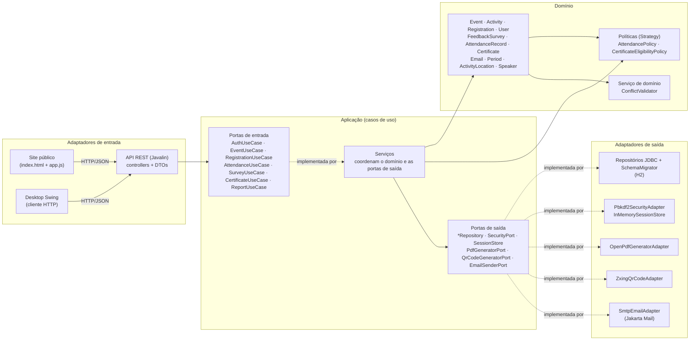

# Arquitetura do EventOS

Arquitetura **hexagonal (portas e adaptadores)**, em Java 21, **sem Spring**: a ligação entre as partes é manual, em um único
*composition root* ([`EventosApplication`](../src/main/java/com/eventos/EventosApplication.java)). O diagrama abaixo corresponde ao código atual.

## Visão em camadas

Pontos que decorrem do desenho:

- O **site e o desktop consomem a mesma API** e só a camada JDBC acessa o banco (RNF-02, RN-18). O desktop **não importa** nenhuma classe de
  domínio ou de aplicação: tem modelos de visão próprios.
- A **API não serializa entidades de domínio**: os controllers devolvem DTOs ([`ApiDtos`](../src/main/java/com/eventos/adapters/input/rest/ApiDtos.java))
  e leem requisições tipadas ([`ApiRequests`](../src/main/java/com/eventos/adapters/input/rest/ApiRequests.java)). O contrato JSON pode evoluir sem mexer no modelo.
- A regra de dependência (**dentro não conhece fora**) é verificada automaticamente por
  [`ArchitectureRulesTest`](../src/test/java/com/eventos/ArchitectureRulesTest.java), que lê os imports reais do código.

## Pacotes e responsabilidades

| Pacote | Responsabilidade | Depende de |
|---|---|---|
| `domain.model` | Entidades e objetos de valor com **comportamento e invariantes** (`Event`, `Activity`, `Registration`, `FeedbackSurvey`, `Period`, `Email`…) | só do próprio domínio |
| `domain.policies` | Estratégias de frequência e de elegibilidade de certificado, com suas fábricas | `domain.model` |
| `domain.services` | `ConflictValidator`: política uniforme de conflitos (sala e agenda) | `domain.model` |
| `domain.exceptions` | Falhas do domínio como tipos próprios (`ValidationException`, `BusinessRuleException`, `ConflictException`, `ForbiddenException`…) | — |
| `application.ports.input` | Casos de uso oferecidos (interfaces) | domínio |
| `application.ports.output` | O que a aplicação precisa do mundo externo (interfaces) | domínio |
| `application.services` | Implementam os casos de uso coordenando domínio e portas de saída | portas e domínio |
| `application.dtos` / `commands` | Resultados e comandos próprios da camada | domínio |
| `adapters.input.rest` | Controllers por área, DTOs, mapeamento, autorização e tratamento de erros HTTP | casos de uso |
| `adapters.input.desktop` | Cliente Swing da API (login, abas, construtor de questionário…) | só HTTP |
| `adapters.output.persistence` | Repositórios JDBC, migrador de esquema e seed | portas de saída |
| `adapters.output.security` | PBKDF2, HMAC do QR Code, sessões opacas em memória | portas de saída |
| `adapters.output.pdf` / `qr` / `email` | OpenPDF, ZXing e SMTP (Jakarta Mail) atrás de portas | portas de saída |
| `EventosApplication` | *Composition root*: cria e liga tudo | todos |

## Onde ficam as regras (e onde não ficam)

| Regra | Dono |
|---|---|
| Abrir inscrição, prazo, capacidade do evento, seleção obrigatória/desabilitada | `Event.assertCanRegister` e `Event.admits` |
| Vagas da atividade | `Activity.bookSlot`/`assertHasAvailableSlot` (regra) + `ActivityRepository.reserveSlot` (atomicidade no banco) |
| Estado da inscrição e acesso à atividade | `Registration` |
| Conflito de sala e de agenda | `ConflictValidator`, acionado por `Event.addActivity` e pelo serviço de inscrição |
| Como interpretar uma leitura de QR e qual a situação de presença | `AttendancePolicy` (cada estratégia) |
| Corrigir presença preservando o histórico | `AttendanceRecord.effective` + registro `REVOCATION` |
| Quem pode avaliar e como validar/consolidar respostas | `FeedbackSurvey`, `SurveyQuestion` e `QuestionType` |
| Elegibilidade ao certificado | `CertificateEligibilityPolicy` sobre `ParticipationSummary` |
| Quem pode chamar o quê | `AuthorizationHandler` e `ApiSupport` (servidor), nunca a interface |

Os serviços de aplicação **não decidem regra**: carregam objetos, chamam o comportamento do domínio e gravam o resultado.

## Fluxos de execução

**Inscrição pelo site:** `app.js` → `POST /api/registrations` → `RegistrationController` (identidade vem da sessão) →
`RegistrationServiceImpl.registerForEvent` → `Event.assertCanRegister` (regras) → `ConflictValidator` (agenda) →
`ActivityRepository.reserveSlot` (vaga atômica; desfaz tudo se uma atividade lotar) → `RegistrationRepository.save` (transação).

**Presença por QR Code:** organizador gera o QR (`GET /attendance/qr/generate/{id}`, imagem criada pelo `ZxingQrCodeAdapter`, conteúdo
assinado pelo `Pbkdf2SecurityAdapter`) → participante autenticado envia o conteúdo (`POST /attendance/qr/scan`) →
`AttendanceServiceImpl` valida assinatura/validade, inscrição e então pergunta à **política da atividade** o que fazer
(`decideQrMark`: registrar, reconhecer repetição ou recusar) → grava `AttendanceRecord` com horário no fuso do evento.

## Segurança

| Tema | Como |
|---|---|
| Senhas | PBKDF2-HMAC-SHA256, 120 000 iterações, sal aleatório de 16 bytes; hashes SHA-256 antigos são aceitos uma vez e migrados no login |
| Sessão | Token opaco de 256 bits, 8 horas, guardado no servidor (revogável por logout) |
| Autorização | Sempre no servidor: 401 sem sessão, 403 sem permissão; organizador só gerencia os próprios eventos |
| Cadastro público | Sempre cria `PARTICIPANT`; organizadores são criados por administradores |
| QR Code | HMAC-SHA256, validade de 15 minutos, sem dado pessoal; segredo vem de `EVENTOS_QR_SECRET` (ou aleatório por execução) |
| Entrada | Validada no domínio; JSON inválido, enum desconhecido e datas ruins viram 400 com mensagem clara |
| Privacidade | Hash nunca exposto; `GET /users` só para admin; verificação pública de certificado sem identificadores internos; política de anonimato das avaliações declarada antes do envio |
| Front-end | Todo dado da API é escapado antes de ir para o HTML |
| Logs | SLF4J: falhas de regra como aviso, inesperadas como erro; senhas e tokens nunca são registrados |

## Banco de dados

H2 relacional acessado por JDBC puro. O esquema é criado e evoluído por scripts versionados em
[`src/main/resources/db/migration`](../src/main/resources/db/migration) (lista em `MANIFEST.txt`), aplicados por um
[`SchemaMigrator`](../src/main/java/com/eventos/adapters/output/persistence/SchemaMigrator.java) próprio que registra cada versão em `schema_version`.
Funciona do zero e adota bancos criados por versões anteriores. URL configurável por `EVENTOS_DB_URL` (testes usam memória).
