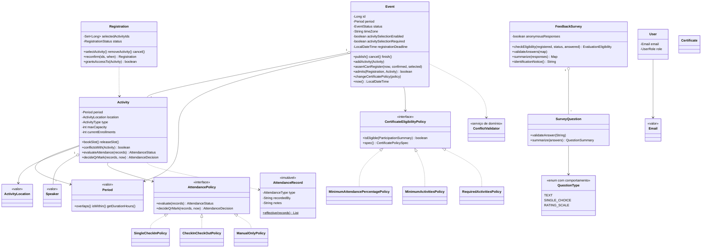

# Modelo de domínio e mapa de responsabilidades

Complementa o [diagrama arquitetural](ARQUITETURA.md). Tudo aqui está em
[`com.eventos.domain`](../src/main/java/com/eventos/domain) e não depende de interface, banco ou framework.

## Glossário

| Termo | Significado no sistema |
|---|---|
| Evento | Agregado raiz. Tem período, fuso, estado (rascunho, publicado, em andamento, encerrado, cancelado), capacidade, regras de inscrição e política de certificado. |
| Atividade | Item da programação (palestra, oficina, apresentação oral, pôster, mesa, outro) em uma sala/trilha, com capacidade, palestrantes e **política de frequência própria**. |
| Trilha/espaço | Agrupamento temático ou físico da atividade (`ActivityLocation.spaceOrTrack`). |
| Pessoa vinculada (`Speaker`) | Palestrante, apresentador ou responsável de uma atividade, com papel e foto opcional. |
| Inscrição | Vínculo confirmado ou cancelado de um participante com um evento e, quando aplicável, com atividades escolhidas. |
| Agenda | Atividades do participante, derivadas da inscrição (RN-08). |
| Política de frequência | Estratégia que diz como a presença de uma atividade é registrada e calculada. |
| Registro de frequência | Marcação imutável (entrada, saída, manual ou revogação) com horário, origem e justificativa. |
| Revogação | Registro que invalida as marcações anteriores do participante sem apagá-las (correção auditável). |
| Questionário | Perguntas (texto, escolha única, escala 1–5) de uma atividade, com política de anonimato. |
| Elegibilidade | Regra configurável do evento que decide quem recebe certificado. |

## Diagrama de classes (núcleo)

Composição em vez de herança: as variações (frequência, elegibilidade, tipo de pergunta) são **interfaces e estratégias**; não há
hierarquia de classes de atividade. Tipo de atividade é um atributo (`ActivityType`), não uma subclasse, porque as atividades não
diferem em comportamento — diferem em dados e na política de frequência escolhida.

## Mapa de responsabilidades

| Classe | O que ela sabe e garante | Colabora com |
|---|---|---|
| `Event` | Ciclo de vida e visibilidade; período e fuso; atividades dentro do período e sem conflito de sala; todas as regras de aceitação de inscrição; congelamento da política de certificado | `Activity`, `Registration`, `ConflictValidator`, `CertificateEligibilityPolicy` |
| `Activity` | Capacidade e vagas; conflitos de sala/horário; situação de presença e decisão sobre leitura de QR (delegadas à política); política imutável | `AttendancePolicy`, `AttendanceRecord` |
| `Registration` | Estado da inscrição; atividades escolhidas; se dá acesso a uma atividade; reinscrição | `Activity` |
| `AttendanceRecord` | Registro imutável; quais registros ainda valem após revogações | — |
| `AttendancePolicy` (3 estratégias) | Situação (`PRESENT`/`PARTIAL`/`ABSENT`) e decisão para uma leitura de QR (registrar, repetição, recusa) | `AttendanceRecord` |
| `FeedbackSurvey` | Quem pode responder (e o motivo da recusa); validação das respostas; consolidação; texto da política de anonimato | `SurveyQuestion`, `SurveyResponse` |
| `QuestionType` | Validar a definição, validar uma resposta e consolidar respostas de **cada tipo** | `SurveyQuestion` |
| `CertificateEligibilityPolicy` (3) | Se um `ParticipationSummary` atende ao critério; descrição legível; descritor para persistir | — |
| `ConflictValidator` | Política única: conflitos de sala e de agenda são **bloqueados** com mensagem que cita a colisão | `Activity` |
| `Period` | Intervalo válido, sobreposição, contenção, duração | — |
| `Email` | Formato e normalização; identifica a conta (RN-01) | — |
| `User` | Perfil e hash da senha; atualização de nome, senha e perfil | `Email` |
| `Certificate` | Dados do titular e código verificável (imutável) | — |

## Invariantes protegidas no domínio

- Título, período e local são obrigatórios; início não pode ser posterior ao fim (`Period`).
- Atividade dentro do período do evento; alterar o período não pode deixar atividade de fora.
- Sala não pode ter duas atividades ao mesmo tempo; agenda do participante não pode ter horários sobrepostos.
- Evento só é publicado com atividades; evento encerrado ou cancelado não é editado, nem recebe atividades.
- Inscrição só em evento publicado, dentro do prazo, abaixo da capacidade e respeitando a regra de seleção (RN-04, RN-05).
- Vagas nunca ultrapassam a capacidade nem ficam negativas.
- Inscrição cancelada não aceita escolhas; reinscrição só depois do cancelamento.
- Política de frequência da atividade não muda depois de criada; política de certificado congela ao encerrar o evento (RN-16).
- Registros de frequência são imutáveis; correção é uma revogação com autor e justificativa (RN-11, RN-12).
- Pergunta de escolha única tem ao menos duas opções; escala é de 1 a 5; resposta a pergunta inexistente é recusada.
- Só avalia quem está inscrito, com presença validada, uma única vez, em questionário ativo (RN-13, RN-14).
- Percentual de presença exigido está entre 0 (exclusivo) e 100; atividades obrigatórias não podem ser vazias.

## Erros do domínio (ROO-11)

| Exceção | Quando | HTTP |
|---|---|---|
| `ValidationException` | Dado inválido ou ausente | 400 |
| `BusinessRuleException` | Regra violada em estado válido (evento fechado, lotado, não inscrito…) | 400 |
| `ConflictException` | Sala ocupada ou conflito de agenda | 409 |
| `EntityNotFoundException` | Recurso inexistente | 404 |
| `UnauthorizedException` | Sem sessão / credenciais inválidas | 401 |
| `ForbiddenException` | Sem permissão | 403 |

Todas estendem `DomainException` e carregam mensagem em português compreensível ao usuário.
